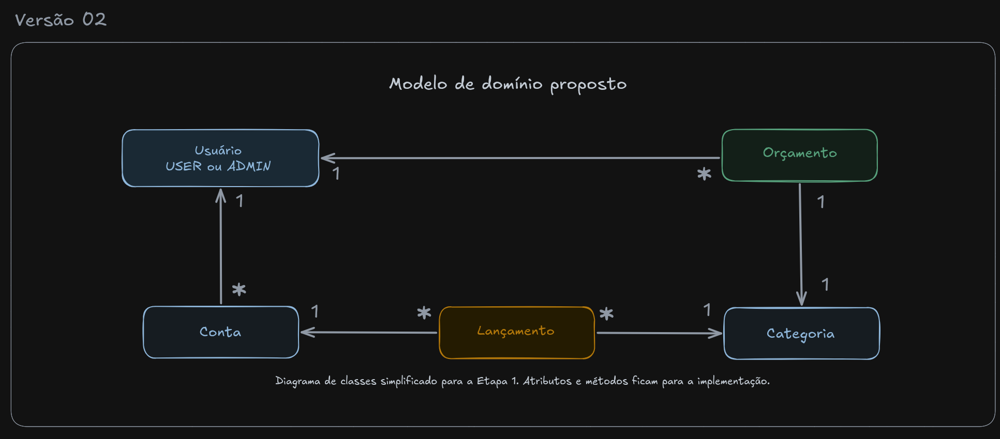

# Sistema Web de Gestão Financeira Pessoal

Projeto acadêmico da disciplina de Desenvolvimento de Aplicações Web I (DAW I) do IFTM, desenvolvido em dupla por Lucas Emmanuel e Rafaella Nunes.

O sistema permite que cada usuário registre receitas e despesas em suas contas, classifique os lançamentos por categoria, defina orçamentos de gasto e gere um relatório mensal em PDF.

## Situação atual

- **Etapa 1** (tema e diagrama de classes simplificado): apresentada ao professor.
- **Etapa 2** (classes do modelo): em andamento.

## Modelo de domínio



O código é escrito em inglês. Os nomes do diagrama correspondem às classes assim: Usuário = `User`, Conta = `Account`, Lançamento = `Transaction`, Categoria = `Category` e Orçamento = `Budget`.

É um diagrama de classes: cada seta indica que a classe de origem tem um atributo do tipo da classe de destino.

- `Account` tem um `User`
- `Budget` tem um `User` e uma `Category`
- `Transaction` tem uma `Account` e uma `Category`

O `User` tem o papel `USER` ou `ADMIN`. As categorias são cadastradas pelo ADMIN, e esse é o CRUD independente que o enunciado pede.

## Tecnologias

Java, Spring Boot, JPA/Hibernate, Spring Data, Flyway, Thymeleaf, htmx, Tailwind CSS e Spring Security com HTTPS.

## Documentação

| Documento | Descrição |
|---|---|
| [Enunciado do trabalho](docs/enunciado-trabalho-final-daw1.pdf) | PDF enviado pelo professor com os requisitos e as etapas |
| [Proposta do projeto](docs/proposta-do-projeto.md) | Tema, diagrama, como vamos atender cada requisito, tipos de usuário e lógica de negócio |
| [Diagrama de classes](docs/diagrama-classes/diagrama-classes.excalidraw) | Diagrama simplificado da Etapa 1: rascunho no papel, Versão 01 e Versão 02 (final) |
| [Diagrama de implementação](docs/diagrama-classes/diagrama-classes-implementacao.excalidraw) | Classes em inglês com atributos e tipos, usado na Etapa 2 |

Os arquivos `.excalidraw` podem ser abertos em [excalidraw.com](https://excalidraw.com/), pela opção **Abrir**.

## Etapas do trabalho

1. Tema, dupla e diagrama de classes simplificado.
2. Implementação das classes do modelo.
3. Mapeamento objeto-relacional (JPA).
4. CRUD completo de `Category`.
5. Lógica de negócio: lançamentos, saldo e orçamento.
6. Segurança, cadastro de usuários e HTTPS.
7. Relatório PDF com sub-relatório.
8. Apresentação do sistema funcionando.

## Estrutura do repositório

```text
.
├── docs/
│   ├── enunciado-trabalho-final-daw1.pdf
│   ├── proposta-do-projeto.md
│   └── diagrama-classes/
│       ├── diagrama-classes.excalidraw
│       ├── diagrama-classes-implementacao.excalidraw
│       ├── diagrama-classes-final.png
│       └── diagrama-classes-evolucao.png
├── financialmanagement/        # aplicação Spring Boot (Maven)
├── LICENSE
└── README.md
```

Nos arquivos de documentação, os nomes usam letras minúsculas, palavras separadas por hífen e nenhum espaço ou acento.
